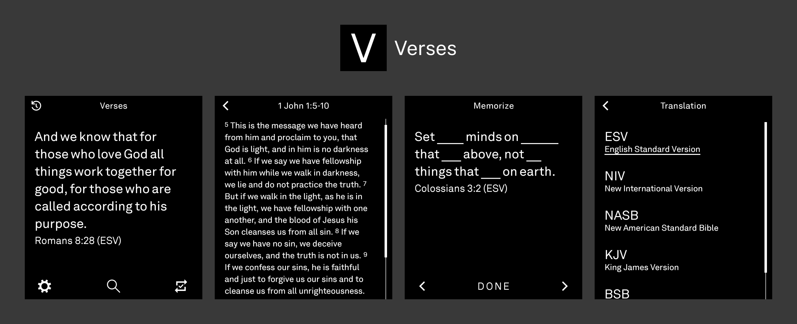

# Verses

A focused Bible reading tool for the Light Phone III, built with the official [Light SDK](https://github.com/lightphone/light-sdk).

---



## Features

* Engage with God's word with the Verse of the Day
* Full access to any verse or passage in the Bible
* Memorize: hide a few random words at a time, with forward/back buttons to gradually hide/reveal the text
* Multiple translations supported, with more on the way
* Add notes to any verse or passage, and reference them anytime


---

## Translations
*If you have a specific version you'd like to see in Verses, [open an issue](https://github.com/zacksimpson/verses-tool/issues?q=state%3Aopen%20label%3ATranslations) with the request and I will gladly look into it!*

**Currently Supported:**
* English Standard Version (ESV)
* New International Version (NIV)
* New American Standard Bible (NASB)
* King James Version (KJV)
* Berean Standard Bible (BSB)
* (More to come!)

### API Keys
KJV and BSB are public domain and work out of the box. ESV, NIV and NASB need a free key of your own, entered in **Settings → Translations → API Keys**:
* ESV: get a key at https://api.esv.org ([step-by-step guide with pictures](guides/esv-guide.md))
* NIV and NASB: get an app key at https://platform.youversion.com/platform/get-started ([step-by-step guide with pictures](guides/niv-nasb-guide.md))

Keys are stored only on your device and are only sent to the service they belong to.

To honor each service's API limits, there is a soft per-device daily limit on lookups for copyrighted translations. In the unlikely event you hit it, lookups for that translation pause until the next day. You can switch to a public domain translation anytime in Settings to keep going.

### Privacy
Verses has no analytics, tracking or ads. The only data that leaves your device is the verse reference you request, sent with your key to the translation's service (api.esv.org, api.youversion.com, or bible.helloao.org for KJV and BSB).

---

## Installing on Light Phone III
* Highly recommend using [Obtainium](https://github.com/ImranR98/Obtainium) to ensure you receive future updates and new features automatically. Just add [the repo URL](https://github.com/zacksimpson/verses-tool/), make sure you're able to install apps from unknown sources, and you're all set.
* Alternatively, you can download the latest APK from the Releases tab.
* Once the official Light SDK matures and LightOS enables support for installing APKs from the Dashboard, installing there will eventually be an option as well – but not for now.
<details>
<summary><strong>Building from Source</strong></summary>

Open in Android Studio, or build from the command line:

```
./gradlew :tool:assembleDebug
```

This repo is the Light SDK with Verses as the `tool` module, so everything outside `tool/` is
unmodified upstream. See `docs/` for the emulator and sideloading instructions.

</details>

---

## Support

If any of my tools have been useful to you, I'd love to hear from you! Feel free to [email me](mailto:zacksimpson24@gmail.com), or [open an issue](https://github.com/zacksimpson/verses-tool/issues/) with your feedback.

---

## Credits

* [The Light Phone](https://www.thelightphone.com) – for building a phone worth making tools for
* [Crossway](https://www.crossway.org) – for the ESV® Bible text, made available via the [ESV API](https://api.esv.org)
* [YouVersion Platform](https://platform.youversion.com) – for the NIV® and NASB® Bible translations, made available via the [YouVersion API](https://developers.youversion.com/api/data-exchange)
