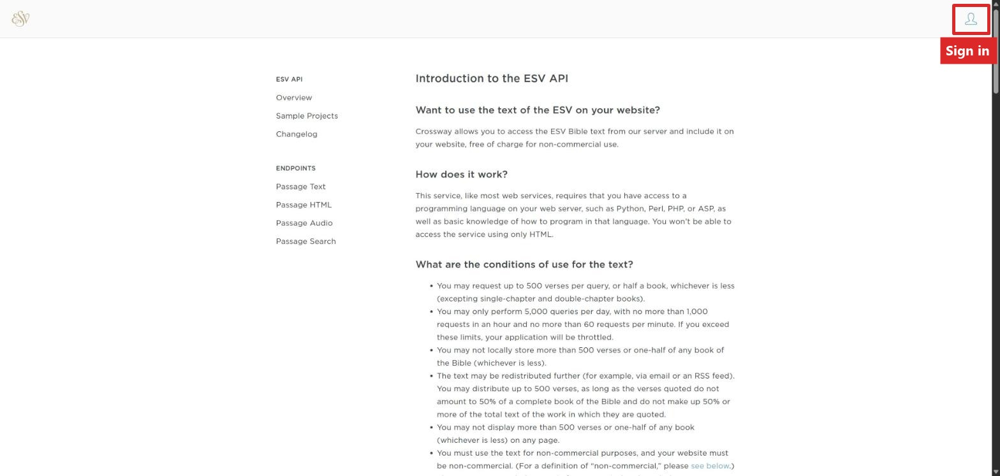
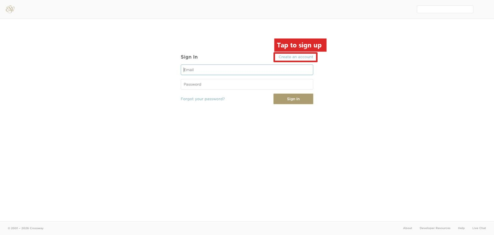
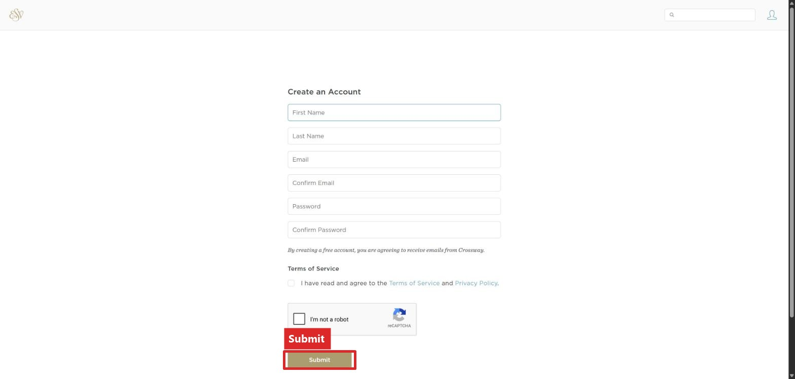
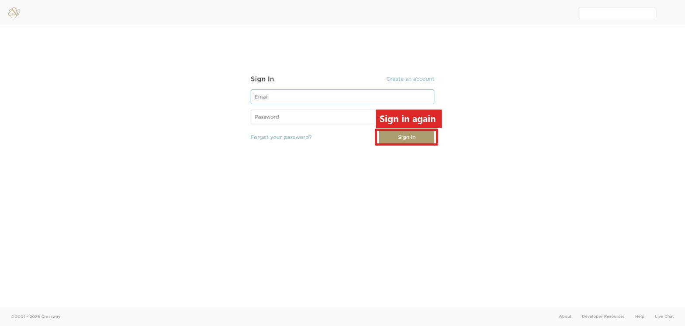
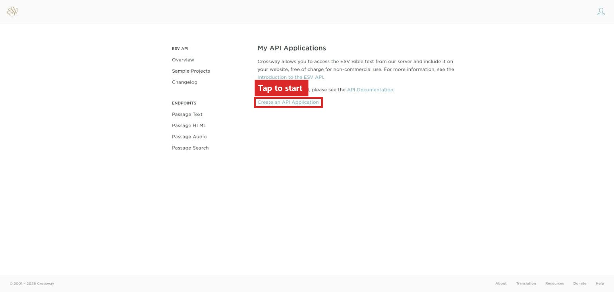
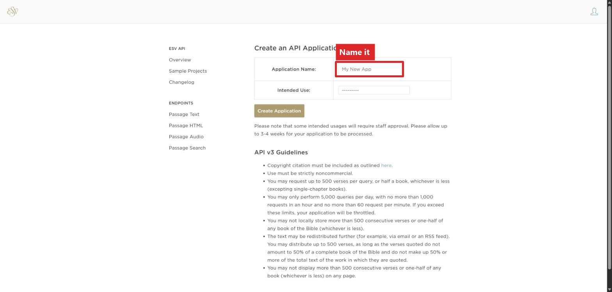
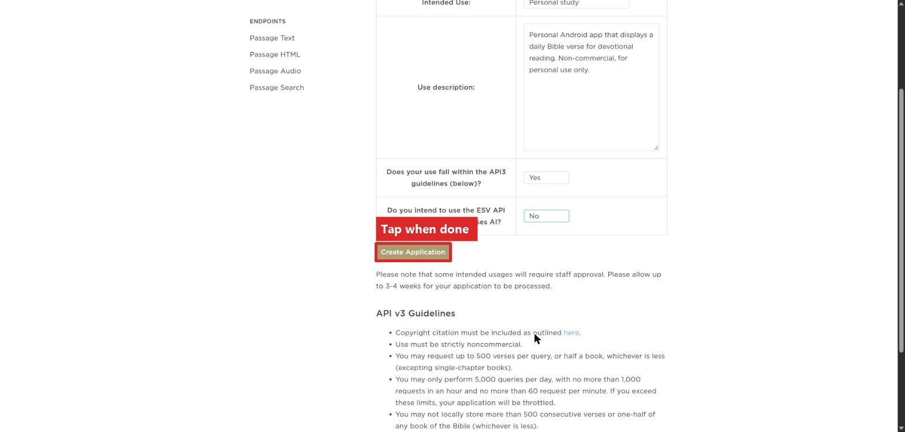
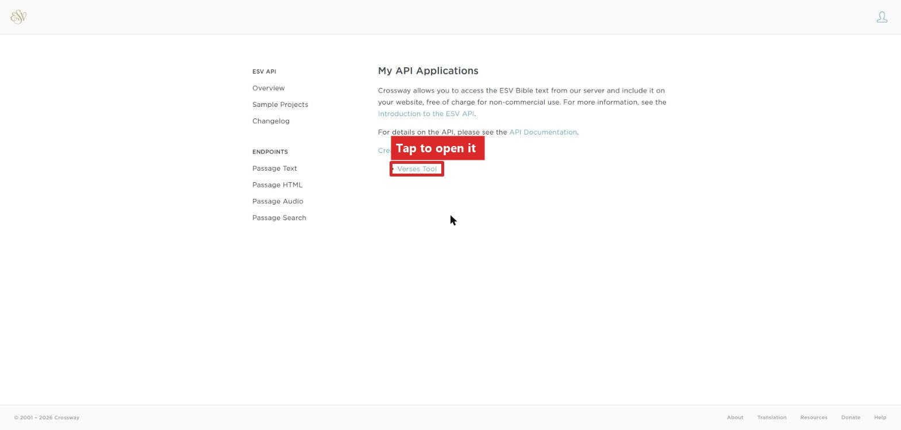
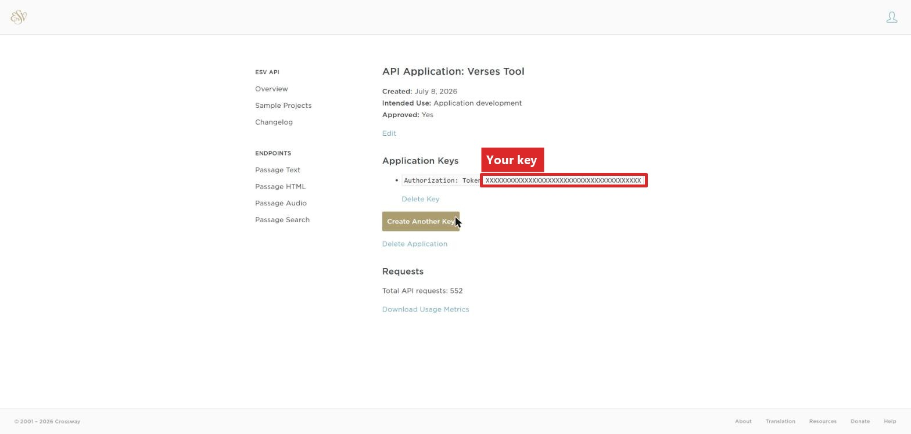

# Getting a Free ESV Key
### This takes about 5 minutes.
The Verses tool needs a free key from Crossway (the publisher of the ESV Bible) to show ESV
text. Do these steps on a computer, then
type the key into your Light Phone at the end.

## 1. Go to the ESV website

Open [api.esv.org](https://api.esv.org/) in a browser.

## 2. Sign in or sign up

Tap the person icon in the top right.

If you don't already have an account, tap **Create an account** and fill in your name,
email, and a password.

## 3. Sign in a second time

After signing up, go back to [api.esv.org](https://api.esv.org/) and sign in again.
This page keeps its own separate sign-in, so don't worry if it asks you again. This is
expected.

## 4. Create an application

You'll land on a page called **My API Applications**. The first time, it will be
empty.

Tap **Create an API Application**.

Fill in a name (can be whatever you want) and a sentence about what you will use it for, then answer the
other questions. Here's what a filled-out form looks like:

Tap **Create Application**.

## 5. Find your key

Back on **My API Applications**, you'll now see the application you just made.

Tap it. You'll see a long string of letters and numbers next to **Authorization:
Token**. That's your key.

Keep this screen pulled up. (Always a good idea to save this key somewhere else safe too)

## 6. Add the key to Verses

On your Light Phone, go to **Settings → Translations → API Keys → ESV API Key → Enter
Key**, and type the key you copied. (It's case-sensitive)

That's it! ESV passages will now work in Verses. 
