# Getting a Free YouVersion Key for NIV and NASB
### This one-time setup takes about 8 minutes.
NIV and NASB come from YouVersion, so they need their own free key. One key can cover both translations.
 Do these steps on a computer, then type the key into your
Verses tool at the end.

> **Note:** Right now, the Verses tool only supports NIV and NASB from YouVersion. Other
> YouVersion translations aren't wired up yet. If there's one you'd like to see added,
> [open an issue](https://github.com/zacksimpson/verses-tool/issues/new?labels=Translations)
> with the request!

## 1. Go to the YouVersion Platform site

Open [platform.youversion.com](https://platform.youversion.com/) and tap **Join the
YouVersion Platform**.

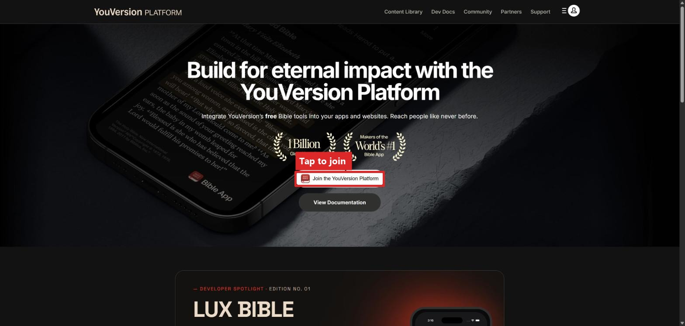

## 2. Sign in or sign up

Sign in with your YouVersion account, or create one if you don't have one.

## 3. Register your account

Choose **Individual**, fill in the rest, and tap **Submit**.

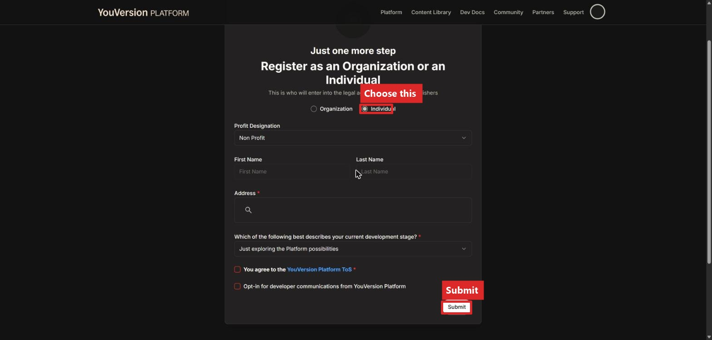

## 4. Start your application

You'll land on a **Get Started** page. Tap **Register your YVP App**.

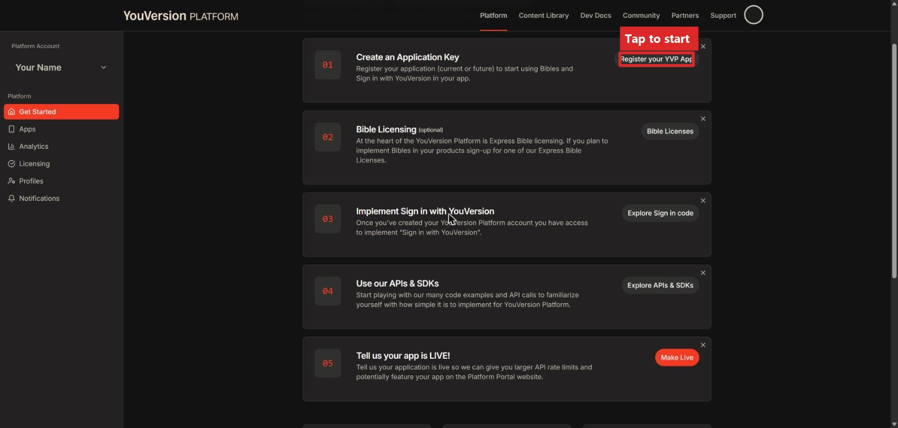

This takes you to the **Apps** page, which is empty the first time. Tap **New
Application**.

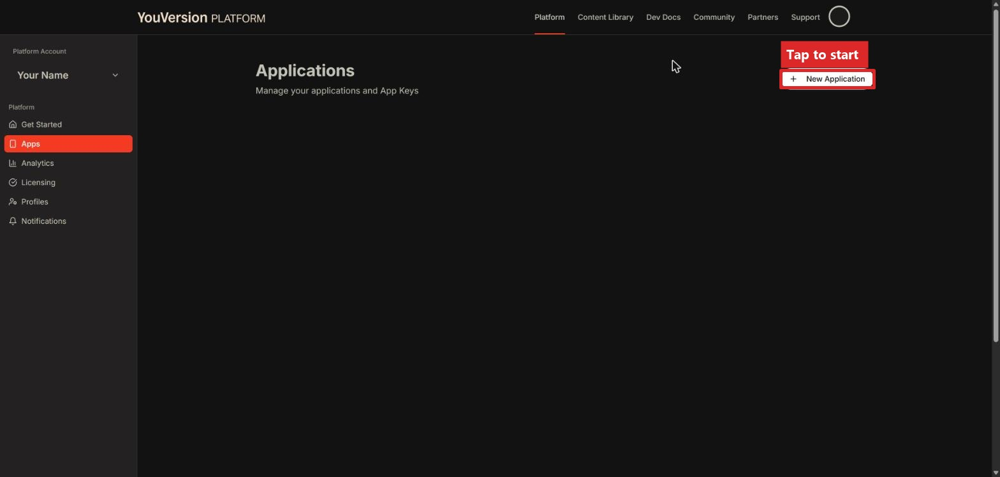

## 5. Fill out the application

Check all three boxes confirming your app is non-commercial, then give it a name.

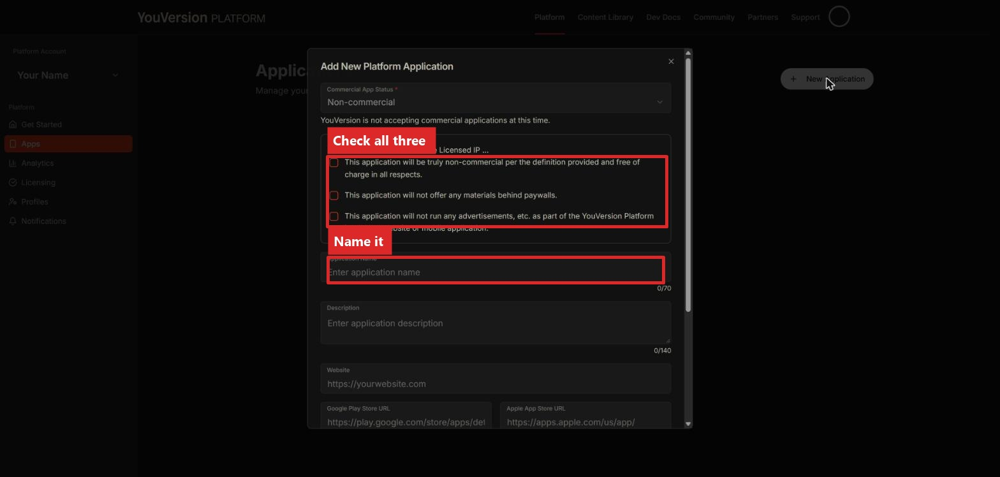

Scroll down and fill in the rest of the fields. A website or app store link isn't
required if you don't have one yet. Tap **Create Application** when you're done.

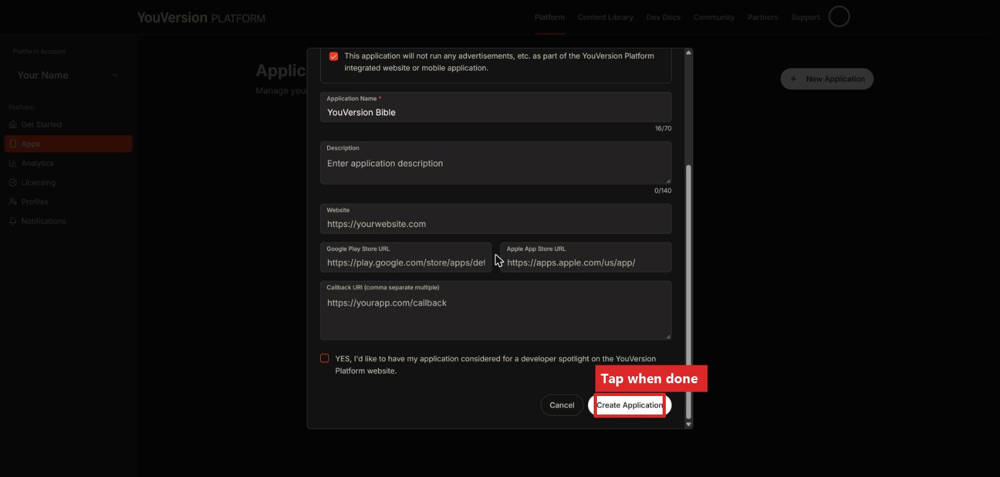

## 6. Get your key

A box pops up with your key. You'll type this key into Verses at the very end. Copy it and save it somewhere safe.

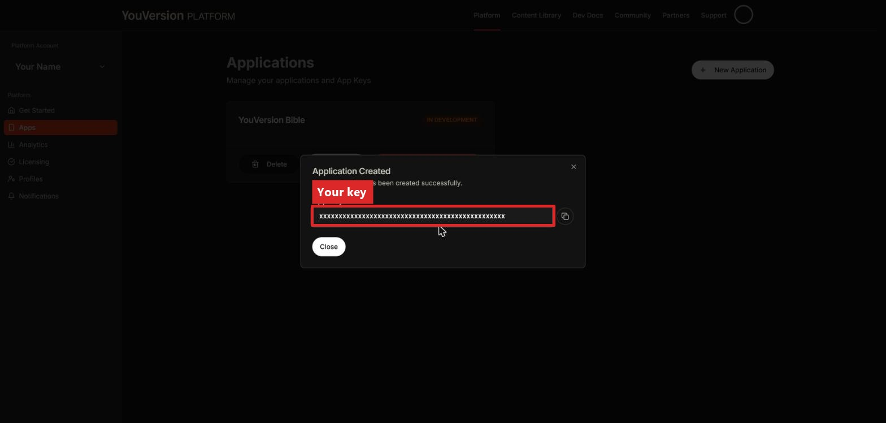

(If you ever need to find it again, go to **Apps** and tap **Details** on your
application.)

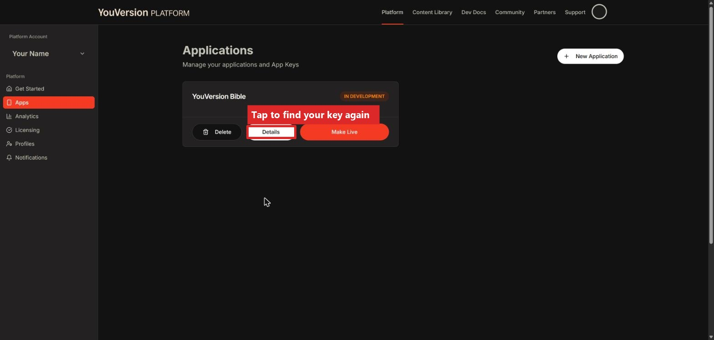

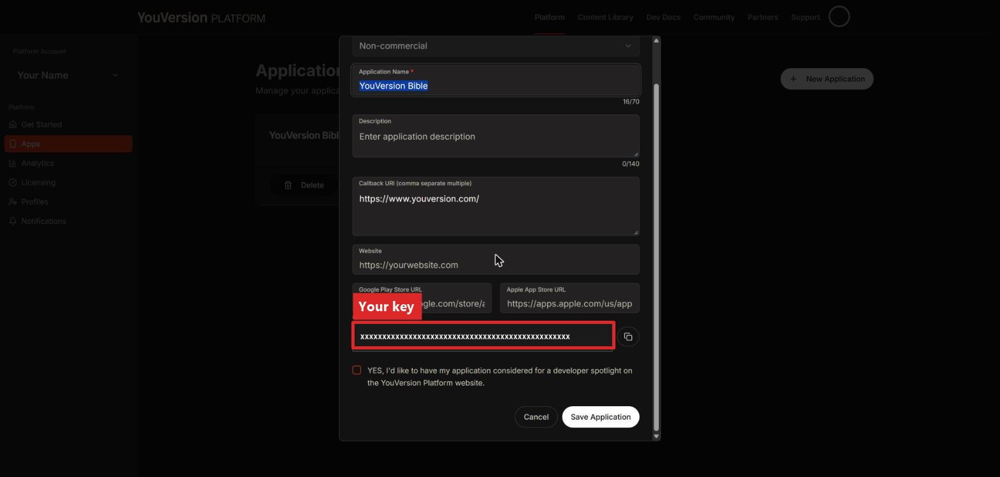

## 7. Get access to NIV and NASB
Next, we need to add NIV and NASB to your app key.
Go to **Licensing** in the sidebar, then check the boxes for **Biblica** (this gives
you NIV) and **Lockman** (this gives you NASB).

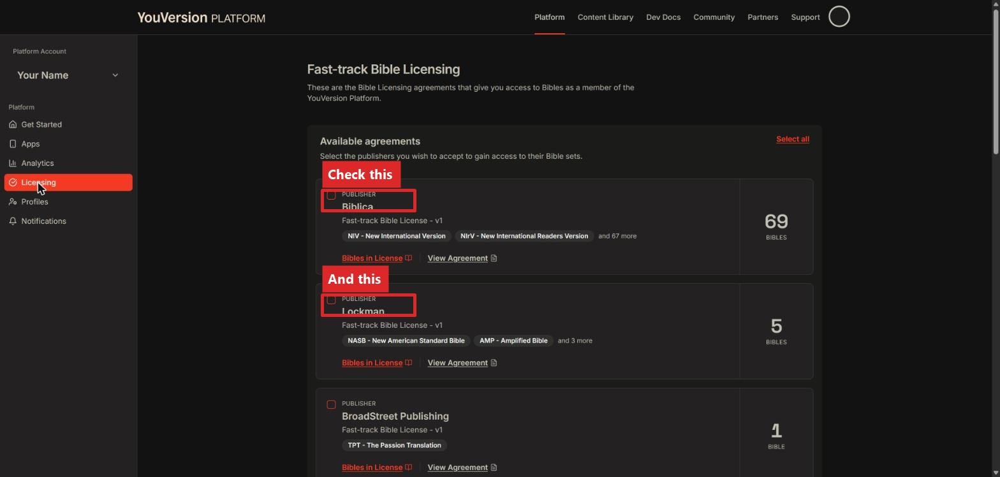

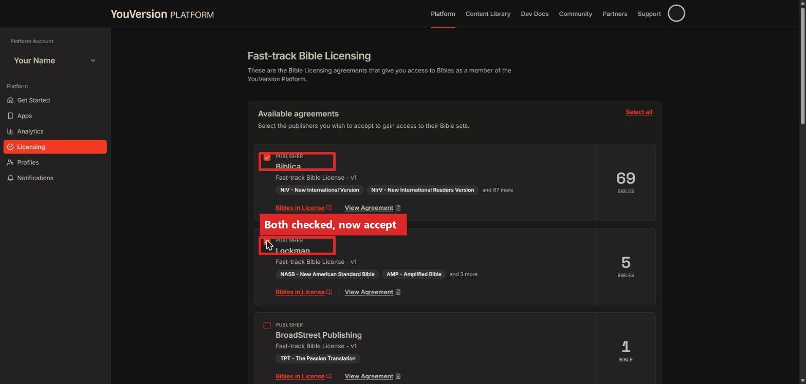

Scroll down and tap **Accept Selected**. Both should now show as Active.

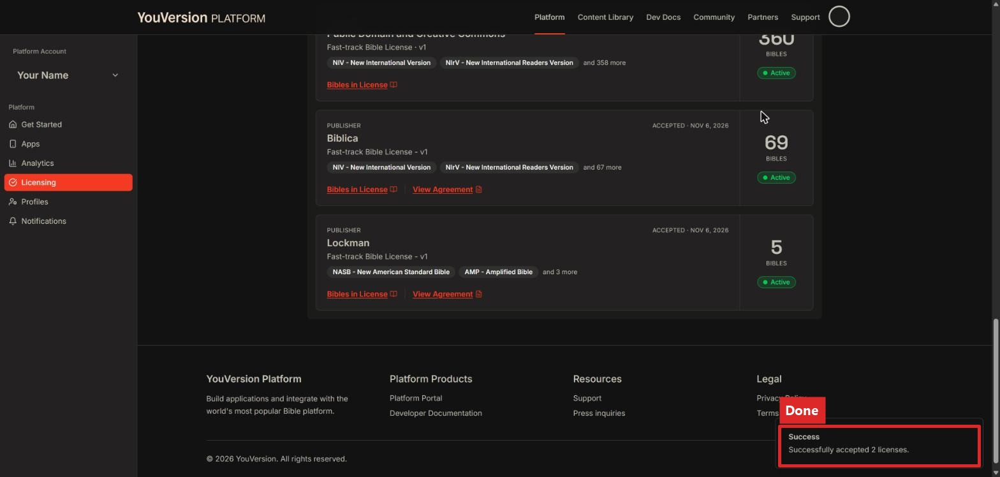

## 8. Add the key to Verses

On your Light Phone, go to **Settings → Translations → API Keys → YouVersion App Key →
Enter Key**, and type the key you copied.

That's it! NIV and NASB passages will now work in Verses.
